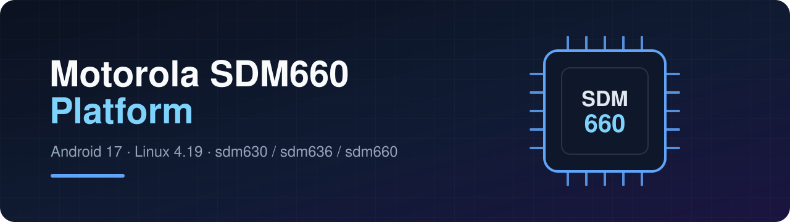

<p align="center">
  
</p>

<p align="center">
  <b>Android 17 and Linux 4.19 for the Motorola Snapdragon 630, 636 and 660 phones.</b><br>
  The family that official builds left on Android 15 and kernel 4.4.
</p>

---

## Why

Every Motorola phone on this platform shares one kernel in official
LineageOS: the msm8998 4.4 tree. Android 16 and later need eBPF features
that kernel can't provide, so those phones stopped at LineageOS 22.2.

This organization moves them to the sdm660 **4.19** kernel used by the
official LineageOS sdm660 devices, with the Motorola hardware brought up
on top of it.

## Devices

| Device | Codename | SoC | LineageOS 24.0 | crDroid 17.0 | TWRP |
|---|---|---|:---:|:---:|:---:|
| Moto X4 | `payton` | sdm630 | ✅ Beta | 🧪 Testing | ✅ 3.7.1 |
| Moto G6 Plus | `evert` | sdm630 | 🔍 Looking for testers | | |
| Moto G7 Plus | `lake` | sdm636 | 🚧 Work in progress | | |
| Moto Z3 Play | `beckham` | sdm636 | 🔍 Looking for testers | | |

## What runs on 4.19

- **Encryption:** FBE with the hardware keymaster, also decrypted from TWRP.
- **Radio:** calls, SMS, mobile data and VoLTE over the rtnetlink rmnet path.
- **Audio:** the Cirrus Logic Madera stack (CS47L35 and CS35L35) on SLIMbus.
- **Camera:** camera_v2-legacy, for the stock 32-bit camera HAL.
- **Graphics:** Adreno V@0502, with Vulkan.
- **Fingerprint:** sensor, plus configurable navigation gestures.
- **Scheduler:** WALT with per-group uclamp, schedutil and BFQ.

## Repositories

| Repository | What it is |
|---|---|
| [android_kernel_motorola_sdm660](https://github.com/moto-sdm660/android_kernel_motorola_sdm660) | The 4.19 kernel: `vendor/sdm660-perf_defconfig` plus the `ext_config` fragments. `lineage-24.0` is the stable branch, `lineage-24.0-perf` adds performance work (MGLRU, LZ4 1.11, devfreq boost, ...) |
| [android_device_motorola_sdm660-common](https://github.com/moto-sdm660/android_device_motorola_sdm660-common) | Configuration shared by every device |
| [android_device_motorola_payton](https://github.com/moto-sdm660/android_device_motorola_payton) | Moto X4 device tree |
| [android_device_motorola_lake](https://github.com/moto-sdm660/android_device_motorola_lake) | Moto G7 Plus device tree (work in progress; kernel branch `lineage-24.0-lake`) |
| [proprietary_vendor_motorola_sdm660-common](https://github.com/moto-sdm660/proprietary_vendor_motorola_sdm660-common) · [proprietary_vendor_motorola_payton](https://github.com/moto-sdm660/proprietary_vendor_motorola_payton) | Proprietary blobs |
| [twrp_device_motorola_payton](https://github.com/moto-sdm660/twrp_device_motorola_payton) · [android_system_vold](https://github.com/moto-sdm660/android_system_vold) | TWRP 12.1 with FBE decryption |
| [local_manifests](https://github.com/moto-sdm660/local_manifests) | One branch per build: `lineage-24.0`, `17.0` (crDroid), `twrp-12.1` |

## Building

```sh
repo init -u https://github.com/LineageOS/android.git -b lineage-24.0 --git-lfs
git clone -b lineage-24.0 https://github.com/moto-sdm660/local_manifests .repo/local_manifests
repo sync
source build/envsetup.sh
lunch lineage_payton-cp2a-userdebug
m bacon
```

For crDroid or TWRP, use the matching branch of
[local_manifests](https://github.com/moto-sdm660/local_manifests).

## Adding a device

The common tree and the kernel are built to be shared. A new device needs:

- an `ext_config/<device>.config` kernel fragment;
- its `motorola/<device>/` device tree, one Makefile line and one Kconfig entry;
- a device tree that inherits `sdm660-common`.

If you own one of the devices above and want to help, open an issue.

## Credits

- **electimon** and the [moto-common](https://github.com/moto-common) msm-4.19
  work, the starting point of the Motorola device trees and the Madera port.
- The **LineageOS** sdm660 kernel and its maintainers, which this kernel is
  based on.
- Everyone whose commits are in these trees: each one keeps its author.

<p align="center"><sub>Maintained by <a href="https://github.com/FPSensor">FPSensor</a></sub></p>
